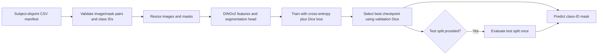

# NeuroLens: brain MRI segmentation baseline

NeuroLens is an early-stage brain-imaging research project. This repository
currently provides a reproducible **2D semantic-segmentation baseline** using
a pretrained DINOv2 backbone and a convolutional prediction head. It loads
paired images and integer label masks, validates subject-level data splits,
trains the segmentation model, reports per-class overlap metrics, and writes
predicted masks.

The conversational research assistant, Meta Muse integration, literature
retrieval, drug-target discovery workflow, longitudinal scan comparison, and
clinical decision support described in the broader project concept are **not
implemented here**. The code is a research prototype, not a diagnostic tool.

## What is implemented

- Manifest-driven image/mask loading with image/mask dimension and class-ID
  validation.
- A guard against subjects appearing in more than one train/validation/test
  split.
- A DINOv2 backbone with a small convolutional segmentation head.
- Combined multiclass cross-entropy and foreground Dice training loss.
- Foreground mean Dice, foreground mean IoU, pixel accuracy, and per-class
  support/Dice/IoU evaluation.
- Checkpoint save/restore and single-image mask prediction.
- A small CPU test suite covering loading, split validation, metrics, and model
  tensor shapes.

## What is not verified

The repository does not include the MRI dataset, pretrained checkpoint,
anatomical label-name mapping, or experiment logs. The current labels
`region_1` through `region_10` are placeholders, not verified anatomical
names. The previously stated 99% accuracy, 98% mean IoU, and 0.002 loss could
not be reproduced or verified from the files available here and are therefore
not presented as results.

The code operates on 2D images. It can report pixel counts, but cannot infer
physical area or anatomical volume without spatial calibration and, for
volume, a 3D scan with voxel spacing. Splits must be defined by subject in the
manifest; splitting halves or slices from the same subject between train and
test does not establish generalization to new subjects.

## Repository layout

```text
.
├── configs/
│   └── manifest.example.csv
├── legacy/
│   ├── README.md
│   └── colab_exports/       # archived original notebook exports
├── src/neurolens/
│   ├── data.py              # manifest, image and mask validation/loading
│   ├── labels.py            # placeholder class-ID mapping
│   ├── metrics.py           # loss and segmentation metrics
│   ├── model.py             # DINOv2 segmentation model
│   ├── predict.py           # checkpoint-based prediction CLI
│   └── train.py             # training/evaluation CLI
├── tests/
└── pyproject.toml
```

The archived Colab exports are not supported entry points; see
[legacy/README.md](legacy/README.md).

## Data format and split setup

Raw images and annotations are not distributed in this repository. Prepare a
CSV manifest with these columns:

| Column | Required | Description |
|---|---:|---|
| `image_path` | Yes | Image path, relative to `--data-root` or absolute |
| `mask_path` | Yes | Single-channel integer label-mask path |
| `subject_id` | Yes | Stable subject/scan grouping identifier |
| `split` | Yes | `train`, `val`, or `test` |
| `channel_index` | No | Channel to select for channels-last multi-channel images |

Start from [configs/manifest.example.csv](configs/manifest.example.csv) and
replace its sample rows. Each mask pixel must contain one integer class ID from
0 through 10, with 0 reserved for background. Confirm the mapping from IDs to
anatomical structures from the source dataset before interpreting outputs.

All samples from one subject must remain in one split. Training requires
non-empty train and validation sets. Test data is optional and, if present, is
evaluated once after the best validation checkpoint is selected. For a
single-subject dataset, the split guard means a valid subject-independent
test is not possible; use such a dataset only for a pipeline smoke test, not
for a generalization claim.

Grayscale inputs are converted to three channels and normalized using a
foreground percentile range. RGB images are accepted directly. A channels-last
TIFF with more than four channels requires `channel_index`; TIFF reading
requires the optional `tifffile` dependency. Masks are never intensity
normalized and are resized with nearest-neighbor interpolation.

## Installation

Python 3.10 or newer is required. Install PyTorch using the command appropriate
for your operating system and CPU/GPU/CUDA setup from
[the official PyTorch selector](https://pytorch.org/get-started/locally/).
Then install this project and its test/TIFF extras:

```bash
python -m venv .venv
# Windows PowerShell:
.venv\Scripts\Activate.ps1
# macOS/Linux:
# source .venv/bin/activate
python -m pip install --upgrade pip
python -m pip install torch
python -m pip install -e ".[dev,tiff]"
```

The pretrained weights for `facebook/dinov2-base` are downloaded from Hugging
Face the first time training starts; internet access is needed unless those
weights are already cached.

## Train and evaluate

With data and a subject-disjoint `data/manifest.csv` prepared:

```bash
neurolens-train --manifest data/manifest.csv --data-root . --output checkpoints/neurolens_dinov2.pt --epochs 20 --batch-size 4 --image-size 448 --seed 42
```

The same command can be run as `python -m neurolens.train` after installing
the package. DINOv2-base uses a 14-pixel patch size, so image dimensions must
be divisible by 14. The default image size is 448. The backbone is frozen by
default; pass `--unfreeze-backbone` to fine-tune it.

Each epoch prints JSON containing training loss and validation metrics. The
checkpoint with the highest foreground mean Dice is saved. If a `test` split
exists, its metrics are printed once after the best checkpoint is restored.
Foreground means include classes present in either references or predictions;
per-class output includes background, and background is included in the loss.

## Predict a mask

```bash
neurolens-predict --checkpoint checkpoints/neurolens_dinov2.pt --image data/new_subject/slice_000.png --output outputs/slice_000_mask.png
```

For a channels-last multichannel input, specify its zero-based channel index:

```bash
neurolens-predict --checkpoint checkpoints/neurolens_dinov2.pt --image data/new_subject/scan.tiff --channel-index 2 --output outputs/slice_000_mask.png
```

The output is a single-channel PNG containing predicted class IDs. Pixel
counts by class are printed as JSON. Predictions are not medical diagnoses.

## Tests

```bash
python -m pytest
```

Tests use synthetic data and a small mock backbone. They do not download DINOv2
weights or establish model accuracy on real MRI data.

## Workflow



## Limitations and next steps

- Replace generic region labels only after verifying the dataset's annotation
  documentation.
- Confirm subject IDs and use a subject-level split before reporting
  generalization results.
- Verify the input modality, channel order, intensity calibration, and
  normalization against the source dataset; the provided grayscale percentile
  scaling is a baseline, not a validated medical-imaging preprocessing method.
- Add spatial metadata and a 3D pipeline before reporting physical size or
  anatomical volume.
- Build any conversational or literature-retrieval features as separate,
  source-grounded modules, with their own evaluation for answer correctness,
  grounding, abstention, and cost.

## References

- Oquab et al., “DINOv2: Learning Robust Visual Features without Supervision,”
  2023. [Paper](https://arxiv.org/abs/2304.07193).
- [Hugging Face `facebook/dinov2-base` model card](https://huggingface.co/facebook/dinov2-base).
